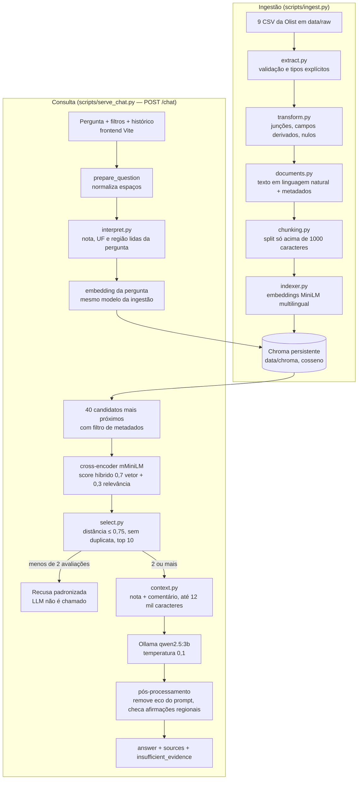

# Voice of Customer Intelligence com RAG — Olist

Tech Challenge da Fase 4 (Pós-Tech IA para Devs). Esta solução de RAG responde em linguagem natural a perguntas sobre as avaliações de clientes da base [Brazilian E-Commerce Public Dataset by Olist](https://www.kaggle.com/datasets/olistbr/brazilian-ecommerce/data). Cada resposta vem com as avaliações que a sustentam. Quando a base não traz evidência suficiente, o sistema recusa.

> **Vídeo de apresentação:** _link a adicionar_

## Sumário

- [Problema de negócio](#problema-de-negócio)
- [Onde cada requisito do desafio é atendido](#onde-cada-requisito-do-desafio-é-atendido)
- [Arquitetura](#arquitetura)
- [Tecnologias e bibliotecas](#tecnologias-e-bibliotecas)
- [Preparação da base](#preparação-da-base)
- [Pipeline RAG](#pipeline-rag)
- [Respostas fundamentadas em evidências](#respostas-fundamentadas-em-evidências)
- [Perguntas sem evidência suficiente](#perguntas-sem-evidência-suficiente)
- [Metadados e exploração contextual (desafio adicional)](#metadados-e-exploração-contextual-desafio-adicional)
- [Principais decisões técnicas](#principais-decisões-técnicas)
- [Instalação e execução](#instalação-e-execução)
- [Exemplos de perguntas e respostas](#exemplos-de-perguntas-e-respostas)
- [Avaliação da recuperação](#avaliação-da-recuperação)
- [Reprodutibilidade](#reprodutibilidade)
- [Limitações e próximos passos](#limitações-e-próximos-passos)
- [Estrutura do repositório](#estrutura-do-repositório)

## Problema de negócio

Um e-commerce acumula milhares de avaliações. A nota mostra o nível de satisfação, mas o motivo está no texto do comentário, e ler isso à mão não escala. Gestores e analistas precisam responder perguntas como:

- Quais são os principais problemas relatados pelos clientes?
- Quais reclamações sobre entrega aparecem com mais frequência?
- O que os clientes mais elogiam?
- Que padrões aparecem nas avaliações de clientes insatisfeitos?
- Quais avaliações sustentam essa conclusão?

A solução transforma os comentários em uma base vetorial consultável. Para cada pergunta, ela recupera as avaliações mais relevantes e usa só esse conteúdo como contexto para um modelo de linguagem escrever a resposta.

## Onde cada requisito do desafio é atendido

| Requisito do enunciado | Onde está |
| --- | --- |
| Construção da base de conhecimento (seleção, limpeza, ausentes, organização, embeddings, indexação) | [Preparação da base](#preparação-da-base), [`docs/ingestion.md`](docs/ingestion.md), [`docs/data_profile.md`](docs/data_profile.md) |
| Pipeline RAG (transformação da pergunta, recuperação semântica, seleção, contexto, geração) | [Pipeline RAG](#pipeline-rag) |
| Respostas fundamentadas em evidências | [Respostas fundamentadas em evidências](#respostas-fundamentadas-em-evidências) |
| Tratamento de perguntas sem evidência suficiente | [Perguntas sem evidência suficiente](#perguntas-sem-evidência-suficiente) |
| Desafio adicional: metadados | [Metadados e exploração contextual](#metadados-e-exploração-contextual-desafio-adicional) |
| Código-fonte | `src/rag/`, `scripts/`, `frontend/` |
| Instruções de instalação e execução | [Instalação e execução](#instalação-e-execução) |
| Arquitetura | [Arquitetura](#arquitetura) |
| Tecnologias e bibliotecas | [Tecnologias e bibliotecas](#tecnologias-e-bibliotecas) |
| Justificativa das decisões técnicas | [Principais decisões técnicas](#principais-decisões-técnicas) |
| Exemplos de perguntas e respostas | [Exemplos de perguntas e respostas](#exemplos-de-perguntas-e-respostas) |
| Informações para reproduzir | [Reprodutibilidade](#reprodutibilidade) |

## Arquitetura

Tudo roda localmente, sem chave de API. A solução tem duas fases: a ingestão, que roda uma vez, e a consulta, que roda a cada pergunta.



| Camada | Módulos | Responsabilidade |
| --- | --- | --- |
| Ingestão | `src/rag/ingestion/` | Ler e validar os CSV, juntar tabelas, montar documentos, fazer o chunking, gerar embeddings e gravar no Chroma |
| Recuperação | `src/rag/retrieval/` | Interpretar a pergunta, montar filtros, fazer a busca vetorial, o rerank com cross-encoder e a seleção das evidências |
| Geração | `src/rag/generation/` | Montar o prompt e o contexto, chamar o Ollama, limpar a resposta, checar a fundamentação e montar o JSON de `/chat` |
| API | `scripts/serve_chat.py` | Servidor HTTP com `POST /chat` (porta 8000) |
| Interface | `frontend/` | Chat em Vite + TypeScript, com filtros e cards de evidência ([`frontend/README.md`](frontend/README.md)) |

## Tecnologias e bibliotecas

Python 3.12.3 (o código pede 3.11+). As versões são as fixadas em `requirements.txt`, que também trava as dependências transitivas.

| Tecnologia | Versão | Uso |
| --- | --- | --- |
| pandas / pyarrow | 3.1.0 / 26.0.0 | Leitura dos CSV, junções, agregações e o `documents.parquet` |
| langchain-core / langchain-text-splitters | 1.7.0 / 1.1.3 | Tipo `Document` e `RecursiveCharacterTextSplitter` |
| langchain-huggingface / sentence-transformers | 1.2.3 / 5.7.0 | Embeddings locais e o cross-encoder de rerank |
| torch | 2.14.1 | Inferência dos dois modelos, fixada na CPU |
| chromadb / langchain-chroma | 1.5.9 / 1.1.0 | Banco vetorial persistente (HNSW, cosseno) |
| pydantic-settings / python-dotenv | 2.16.1 / 1.2.4 | Configuração via `.env` |
| tqdm | 4.70.1 | Progresso da ingestão |
| pytest | 9.1.1 | Testes com CSV mínimos em `tests/fixtures/` |
| Ollama | — | Servidor local do LLM (`http://127.0.0.1:11434`) |

Modelos:

| Papel | Modelo | Por quê |
| --- | --- | --- |
| Embedding | `sentence-transformers/paraphrase-multilingual-MiniLM-L12-v2` | Multilingual (os comentários estão em pt-BR), leve, roda na CPU |
| Rerank | `cross-encoder/mmarco-mMiniLMv2-L12-H384-v1` | Cross-encoder multilingual treinado em mMARCO. Lê a pergunta e o comentário juntos |
| Geração | `qwen2.5:3b` via Ollama | Bom em português para o tamanho e roda localmente sem GPU dedicada |

Frontend (Node 20+): Vite 8.3, TypeScript 7.0, Tailwind CSS 4.3, daisyUI 5.7.

## Preparação da base

O perfil completo dos dados, coluna a coluna, está em [`docs/data_profile.md`](docs/data_profile.md), e o desenho da ingestão em [`docs/ingestion.md`](docs/ingestion.md). O extrato tem 99.441 pedidos (2016-09-04 a 2018-10-17) e 99.224 avaliações.

### Seleção dos dados

- Os nove CSV são validados: a execução para e lista o que falta se um arquivo ou coluna obrigatória estiver ausente.
- Entram pedidos, clientes, itens, produtos, tradução de categoria, vendedores, pagamentos e avaliações.
- A geolocalização (1.000.163 linhas) é validada, mas não é carregada. Cidade e UF já vêm de clientes e vendedores, e a coordenada não ajuda a responder perguntas sobre comentários.

### Limpeza e preparação dos textos

- Todas as junções são à esquerda, para um cadastro faltante não derrubar o pedido.
- Campos derivados: atraso em dias entre a entrega e a data estimada, valor total (soma dos pagamentos, ou preço + frete quando não há pagamento) e quantidade de itens.
- O comentário fica como o cliente escreveu: sem lematização e sem remover stopwords. Um modelo de embedding de sentenças funciona melhor com o texto natural.
- A categoria aparece em inglês (arquivo de tradução) e em português. As duas sem tradução (`pc_gamer` e `portateis_cozinha_e_preparadores_de_alimentos`) ficam em português.

### Tratamento de valores ausentes

| Situação | Volume | Tratamento |
| --- | --- | --- |
| Avaliação sem comentário | 58,70% | A frase de comentário sai do texto. Não há documento `review` para ela |
| Avaliação sem título | 88,34% | A frase de título sai do texto |
| Produto sem categoria | 610 (1,85%) | A frase de categoria sai. O metadado fica `""` |
| Pedido entregue sem data de entrega | 8 | O atraso vira a sentinela `-9999` |
| Pagamento com 0 parcelas | 2 | A parcela não entra no texto |
| Pedido sem nota | — | `review_score = -1` (o Chroma não aceita `None`) |

A regra geral é que nulo nunca vira `nan` no texto: a frase inteira some.

### Organização dos documentos

Uma linha tabular crua é um documento ruim para embedding. Por isso cada entidade vira um texto em linguagem natural:

| `doc_type` | Unidade | Uso |
| --- | --- | --- |
| `review` | Uma avaliação com comentário (40.950 no extrato completo) | **Principal fonte de evidência do chat** |
| `order` | Um pedido com itens, pagamento, prazo e avaliação | Contexto do pedido |
| `category_summary` | Agregado por categoria | Visão geral (nota média, atraso médio) |
| `state_summary` | Agregado por UF | Visão geral por estado |

Exemplo de documento `review`:

```text
Review score: 1/5 on order e62c3201015050463bc2e3b6599a6bc5, placed on 2018-02-27 by a customer from rio de janeiro/RJ. Items: baby (bebes). Seller from sao paulo/SP. Review comment: Comprei o produto e até o momento não recebi ...
```

Antes de ir para o cross-encoder e para o prompt, `customer_text()` corta esse cabeçalho e deixa só o título e o comentário. Um modelo pequeno confundia o cabeçalho em inglês com a avaliação.

### Criação dos embeddings

- O modelo multilingual roda na CPU, com vetores normalizados.
- Documentos com até 1000 caracteres ficam em um chunk só, que é o caso de praticamente todos (na amostra de 1.000 pedidos, os 1.495 documentos ficaram abaixo do limite). Acima disso, o `RecursiveCharacterTextSplitter` corta com sobreposição de 150, e cada pedaço herda os metadados.
- A pergunta é embutida com o mesmo modelo. A coleção grava o nome do modelo e recusa consultas feitas com outro.

### Armazenamento e indexação

- A coleção `olist_ecommerce` fica no Chroma persistente em `data/chroma/`, com HNSW e distância de cosseno.
- O id de cada chunk é o SHA-256 de `doc_type|entity_id|chunk_index`. O upsert é idempotente: rodar duas vezes não duplica nada.
- A coleção guarda modelo, chunking, versão do dataset, data da última compra ingerida e tamanho da amostra. Um modelo ou uma amostra diferentes exigem `--reset`.

Metadados gravados por chunk:

| Campo | Conteúdo |
| --- | --- |
| `doc_type`, `entity_id`, `order_id`, `chunk_index` | Identificação |
| `review_score` | Nota de 1 a 5 (no pedido, a menor), `-1` se não houver |
| `product_category` | Categoria em inglês, ou o nome em português sem tradução |
| `customer_state`, `customer_city`, `seller_state` | Localização |
| `purchase_year`, `purchase_month` | Período da compra |
| `order_status`, `total_value`, `delivery_delay_days` | Pedido e entrega (`-9999` quando a entrega não pode ser comparada) |
| `source_files` | CSV de origem |

## Pipeline RAG

O fluxo segue o do enunciado. Cada etapa está ligada ao código que a implementa.

### 1. Transformação da pergunta

`prepare_question()` ([`retrieval/retrieve.py`](src/rag/retrieval/retrieve.py)) normaliza os espaços e preserva o texto original para o prompt. Depois, `interpret_question()` ([`retrieval/interpret.py`](src/rag/retrieval/interpret.py)) lê, por regras explícitas sobre o texto sem acento, o que a pergunta já diz:

- **Nota:** "nota baixa", "reclamação", "insatisfeito", "problema" → notas 1–3. "Elogio", "nota alta", "satisfeito" → notas 4–5. Se a pergunta tem os dois sinais, nenhum filtro é aplicado.
- **Estado:** nome por extenso ("São Paulo") ou sigla ("SP") → `customer_state`.
- **Região:** "Nordeste", "Sul", etc. → lista de UFs da região.
- **Comparação regional:** "qual região tem mais notas baixas" ativa uma contagem por região (`group.py`) sobre uma busca mais ampla (80 candidatos).
- **Contraste de notas:** uma pergunta que contrapõe notas altas e baixas faz duas buscas separadas (1–3 e 4–5), para um lado não ocupar a lista inteira.

Um filtro enviado pela interface sempre vence o que foi lido no texto.

### 2. Recuperação semântica

A pergunta vira um vetor com o mesmo modelo da ingestão. O Chroma devolve os **40 vizinhos mais próximos** (`candidate_k`) já restritos pelo `where` dos metadados ([`retrieval/filters.py`](src/rag/retrieval/filters.py)). Um intervalo de notas vira `$in`, porque esta versão do Chroma aceita um operador por campo.

### 3. Seleção dos conteúdos mais relevantes

A busca vetorial encontra a vizinhança, mas não garante que o comentário responda à pergunta. Por isso há um segundo estágio ([`retrieval/select.py`](src/rag/retrieval/select.py), [`retrieval/relevance.py`](src/rag/retrieval/relevance.py), [`retrieval/hybrid.py`](src/rag/retrieval/hybrid.py)):

1. **Rerank:** o cross-encoder `mmarco-mMiniLMv2` lê o par (pergunta, comentário) e devolve uma probabilidade de relevância.
2. **Score híbrido:** `0,7 × (1 − distância) + 0,3 × relevância`. O vetor continua pesando mais, e o cross-encoder corrige a ordem dentro da vizinhança.
3. **Cortes:** sai o candidato com distância de cosseno acima de **0,75**, o chunk repetido da mesma entidade, o segundo documento do mesmo pedido e tudo que passar do **top 10**. Cada descarte guarda o motivo (`distance`, `duplicate_chunk`, `duplicate_order`, `beyond_k`).

### 4. Construção do contexto

[`generation/context.py`](src/rag/generation/context.py) e [`generation/evidence.py`](src/rag/generation/evidence.py):

- Uma avaliação só entra no contexto se tiver id, texto e nota de 1 a 5.
- Cada bloco leva só a nota e o comentário (`Nota 1/5\n<comentário>`). Pedido, data, categoria e similaridade ficam fora, para o modelo falar do conteúdo e não dos ids.
- A UF entra só quando a pergunta é sobre lugar. Em uma comparação regional, os blocos vêm agrupados por região, junto com a contagem já calculada.
- O limite é de 10 avaliações e 12.000 caracteres.
- Os últimos 4 turnos da conversa entram como histórico, para perguntas de continuação.

### 5. Geração da resposta

[`generation/prompt.py`](src/rag/generation/prompt.py) e [`generation/ollama.py`](src/rag/generation/ollama.py):

- O prompt de sistema manda responder em pt-BR, em um parágrafo, começando por "As avaliações compartilham". O modelo deve dizer o que se repete e **não inventar causa, quantidade, UF ou região**.
- O modelo é o `qwen2.5:3b` no Ollama, com `temperature 0.1` e até 320 tokens. A temperatura baixa reduz a variação entre execuções.
- Pós-processamento:
  - `without_instruction_echo` remove trechos do prompt que o modelo pequeno às vezes repete;
  - `without_review_mentions` tira referências a uma avaliação específica;
  - `drop_repeated_opening` evita repetir a abertura da resposta anterior;
  - `ground_answer` ([`generation/ground.py`](src/rag/generation/ground.py)) confere frases como "o Norte tem mais problemas". A afirmação só fica se as avaliações citadas mostrarem isso, senão vira uma correção.

## Respostas fundamentadas em evidências

O JSON de `POST /chat` ([`generation/chat.py`](src/rag/generation/chat.py)) devolve a resposta e as avaliações usadas:

```json
{
  "answer": "As avaliações compartilham ...",
  "insufficient_evidence": false,
  "sources": [
    {
      "id": "<sha256 do chunk>",
      "doc_type": "review",
      "order_id": "e62c3201015050463bc2e3b6599a6bc5",
      "review_score": 1,
      "product_category": "baby",
      "purchase_date": "2018-02",
      "score": 0.4775,
      "excerpt": "Comprei o produto e até o momento não recebi ..."
    }
  ]
}
```

- `sources` são exatamente as avaliações que foram para o contexto do modelo, na mesma ordem. O insight pode ser rastreado até o pedido e o comentário.
- `score` é a distância de cosseno: quanto menor, mais próximo.
- A interface mostra cada fonte como um card com nota, categoria, data, trecho, `order_id` e distância.
- Sem LLM, `scripts/ask.py` imprime a resposta montada só com os trechos recuperados, para auditar a recuperação isoladamente.

## Perguntas sem evidência suficiente

O sistema não pede ao modelo para responder quando os dados não sustentam uma resposta:

| Situação | Como é detectada | Resultado |
| --- | --- | --- |
| Nenhuma avaliação relevante | Todo candidato fica acima da distância 0,75 | Recusa |
| Evidência insuficiente | Menos de 2 avaliações selecionadas (`min_keep`) ou menos de 2 válidas para o contexto | Recusa |
| Pergunta fora do escopo | Os vizinhos que ficam longe (distância > 0,75) não passam do corte | Recusa se sobrarem menos de 2 |
| Filtro que esvazia a base | O `where` do Chroma não devolve nada | Recusa |
| Afirmação regional sem suporte | `ground_answer` conta as UFs das avaliações | A frase é substituída por uma correção |

A recusa tem texto fixo, vem com `insufficient_evidence: true` e `sources: []`, e **não chama o LLM**:

> Não há avaliações suficientes para responder com base nos comentários recuperados. Nenhuma resposta foi gerada.

O prompt também orienta o modelo a dizer com naturalidade quando as avaliações recuperadas não mostram o que foi perguntado.

## Metadados e exploração contextual (desafio adicional)

Os metadados restringem a busca **antes** da similaridade. Assim, os 40 candidatos já saem do recorte certo, em vez de a busca devolver vizinhos de outras notas que depois seriam descartados.

| Metadado | Como entra | Contribuição para a recuperação |
| --- | --- | --- |
| `review_score` | Faixa no filtro da interface, ou lida da pergunta ("insatisfeitos" → 1–3, "elogiam" → 4–5) | Uma pergunta sobre problemas não recebe elogios parecidos no texto (ex.: "entrega rápida" vs. "entrega atrasada") |
| `product_category` | Filtro da interface | Permite "o que elogiam em cama, mesa e banho" sem misturar categorias |
| `purchase_year` | Filtro da interface | Recorta o período da compra |
| `customer_state` / região | Lida da pergunta ("em São Paulo", "no Nordeste") | Perguntas regionais e comparações entre regiões com contagem por nota |
| `doc_type` | Filtro da interface | Separa comentários (`review`) de resumos agregados, que competiam com as reclamações nas buscas sobre entrega |

Os campos `delivery_delay_days`, `order_status`, `total_value` e `seller_state` já estão indexados e podem virar filtros novos sem reingestão.

## Principais decisões técnicas

| Decisão | Alternativa considerada | Justificativa |
| --- | --- | --- |
| Texto em linguagem natural por entidade | Indexar a linha do CSV | O embedding captura frases melhor do que colunas soltas, e o pedido reúne item, prazo e avaliação |
| Documento `review` separado do `order` | Só pedidos | Deixa o comentário dominar o vetor. As perguntas do desafio são sobre o que o cliente escreveu |
| Embedding multilingual local (MiniLM-L12) | Modelo em inglês ou API paga | Os comentários estão em pt-BR. Roda na CPU, sem custo e sem enviar dados para fora |
| Chunk de 1000 com split só acima disso | Chunk fixo pequeno | Quase todo documento cabe inteiro, e cortar um comentário curto tira o sentido dele |
| Chroma persistente | FAISS, pgvector | Filtro por metadados nativo, persistência em disco e zero infraestrutura |
| Busca vetorial + rerank com cross-encoder (0,7/0,3) | Só vetor | O vetor acha a vizinhança, mas ordena mal comentários parecidos. O cross-encoder lê a pergunta junto e corrige a ordem |
| Filtros lidos da pergunta por regra | Pedir ao LLM para extrair filtros | É determinístico, testável e não gasta uma chamada de LLM. Um filtro explícito da interface sempre vence |
| Corte de distância 0,75 e mínimo de 2 avaliações | Responder sempre com o top-k | Uma resposta sustentada por 0 ou 1 comentário distante é alucinação disfarçada. Recusar é melhor |
| LLM local `qwen2.5:3b` com temperatura 0,1 | GPT/Claude via API | Reprodutível offline e sem chave. A temperatura baixa mantém a resposta presa ao contexto |
| Contexto só com nota e comentário | Mandar o documento inteiro | O modelo pequeno repetia ids e datas em vez de resumir as reclamações |
| Checagem pós-geração (`ground_answer`) | Confiar no texto do LLM | Afirmações comparativas são o tipo de alucinação mais comum. Elas são conferidas contra as UFs das fontes |
| Servidor `http.server` da biblioteca padrão | FastAPI | Uma rota só, sem dependência extra |

## Instalação e execução

### Pré-requisitos

- Python 3.11+ (testado com 3.12.3)
- Node 20+ (testado com 24.13.1), só para a interface
- [Ollama](https://ollama.com/download), só para a geração com LLM
- Espaço em disco para o `torch` (o wheel fixado traz bibliotecas CUDA, mas a inferência usa a CPU)

### 1. Dados

Baixe o [dataset no Kaggle](https://www.kaggle.com/datasets/olistbr/brazilian-ecommerce/data) e coloque os nove CSV em `data/raw/` (detalhes em [`data/raw/README.md`](data/raw/README.md)).

### 2. Ambiente Python

```bash
make install
```

```bash
cp .env.example .env
```

O `make install` cria `.venv` e instala o `requirements.txt`.

### 3. Ingestão

```bash
make ingest-sample
```

O comando acima ingere uma amostra de 1.000 pedidos (semente 42) em cerca de 40 s. Para a base completa (cerca de 140 mil documentos, por volta de 26 min de embedding na CPU pela taxa medida na amostra):

```bash
.venv/bin/python scripts/ingest.py --reset
```

```bash
make inspect
```

O `make inspect` mostra a contagem por `doc_type` e três buscas de sanidade.

### 4. LLM

```bash
ollama pull qwen2.5:3b
```

Deixe o Ollama aberto. Outro modelo pode ser usado com `OLLAMA_MODEL=<modelo>`.

### 5. API

```bash
PYTHONPATH=src .venv/bin/python scripts/serve_chat.py
```

Na primeira execução, o cross-encoder é baixado do Hugging Face. O servidor fica em `POST http://127.0.0.1:8000/chat`.

### 6. Interface

```bash
cd frontend && npm install && cp .env.example .env
```

Em `frontend/.env`, defina `VITE_USE_MOCK=false` para usar a API real. Depois:

```bash
cd frontend && npm run dev
```

Abra http://localhost:5173. O Vite repassa `/chat` para a porta 8000.

### Ferramentas de linha de comando

| Comando | O que faz |
| --- | --- |
| `make test` | Roda a suíte do pytest sobre os fixtures, sem baixar modelo e sem ler `data/raw/` |
| `make profile` | Regenera [`docs/data_profile.md`](docs/data_profile.md) |
| `make retrieve QUESTION='"..."'` | Mostra o JSON da recuperação e o prompt que iria para o LLM |
| `PYTHONPATH=src .venv/bin/python scripts/ask.py "..."` | Responde citando só os trechos recuperados, sem LLM |
| `make evaluate` | Métricas da recuperação em perguntas fixas |

Teste rápido da API:

```bash
curl -s localhost:8000/chat -H 'Content-Type: application/json' -d '{"question":"O que os clientes relatam sobre atraso na entrega?"}'
```

## Exemplos de perguntas e respostas

As perguntas abaixo são as do enunciado. A coluna "Filtro aplicado" mostra o que `interpret_question` lê de cada uma antes da busca.

| Tipo de investigação | Pergunta | Filtro aplicado |
| --- | --- | --- |
| Reclamações | Quais são os principais problemas relatados pelos clientes? | `review_score` 1–3 ("problemas") |
| Tema específico | O que os clientes relatam sobre problemas relacionados à entrega? | `review_score` 1–3 |
| Experiências positivas | Quais aspectos da experiência de compra são mais elogiados? | `review_score` 4–5 ("elogiados") |
| Insatisfação | Quais padrões aparecem nas avaliações de clientes insatisfeitos? | `review_score` 1–3 ("insatisfeitos") |
| Evidências | Quais avaliações sustentam que há problemas recorrentes no prazo de entrega? | `review_score` 1–3 |
| Recorte geográfico | Em São Paulo, quais são os motivos de nota baixa? | `customer_state=SP`, `review_score` 1–3 |
| Comparação regional | Qual região tem mais notas baixas, Norte ou Sul? | Contagem por região sobre 80 candidatos |
| Fora do escopo | Qual a previsão do tempo para amanhã? | Nenhum. Espera-se recusa se nenhum vizinho ficar abaixo da distância 0,75 |

### Recuperação real sobre a amostra

A saída abaixo é de `scripts/inspect_collection.py` sobre a amostra de 1.000 pedidos. São os três primeiros vizinhos para "produto veio com defeito":

```text
1. score=0.4775 doc_type=review review_score=1
   Review comment: Comprei o produto e até o momento não recebi e também ...
2. score=0.4867 doc_type=review review_score=1
   Review comment: O produto veio errado não tive nen...
3. score=0.5234 doc_type=review review_score=1
   Review title: zero estrela. Review comment: ...
```

Todos são avaliações com nota 1 e comentário em português, que é o tipo de evidência que vai para o contexto do LLM.

### Respostas geradas

<!-- Cole aqui as respostas reais de POST /chat (answer + 2 ou 3 sources) para as perguntas da tabela acima, obtidas com a base completa e qwen2.5:3b. -->

_A preencher com a saída real de `POST /chat`._

### Pergunta sem evidência

```json
{
  "answer": "Não há avaliações suficientes para responder com base nos comentários recuperados. Nenhuma resposta foi gerada.",
  "insufficient_evidence": true,
  "sources": []
}
```

## Avaliação da recuperação

`make evaluate` ([`scripts/evaluate.py`](scripts/evaluate.py)) roda perguntas fixas e mede, sem LLM e sem rótulo manual:

- **acerto:** fração das avaliações selecionadas que contém ao menos um termo esperado (ex.: "atraso", "demorou", "não recebi" para a pergunta de entrega);
- **sim.:** similaridade média (`1 − distância`) das selecionadas;
- **filtros:** o que a interpretação aplicou.

É uma métrica de sanidade para comparar mudanças no pipeline (pesos do score híbrido, corte de distância, modelo), não uma avaliação completa de RAG.

A suíte do pytest (`make test`) cobre extração, transformação, documentos, chunking, indexação, filtros, interpretação, seleção, rerank, agrupamento regional, montagem do prompt, recusa, `ground_answer` e o formato de `/chat`. Os modelos são substituídos por embeddings falsos, então os testes rodam offline.

## Reprodutibilidade

- `requirements.txt` é o `pip freeze` do ambiente usado, com Python 3.12.3. O frontend trava as versões no `package-lock.json`.
- A amostra usa a semente `RANDOM_SEED=42`.
- Modelo, lote, chunk e flags de documento estão em [`.env.example`](.env.example).
- Embedding e cross-encoder rodam com `device=cpu`, então o resultado não depende de GPU. O LLM usa `temperature 0.1`.
- Os ids dos chunks são determinísticos (SHA-256), e a reingestão é idempotente.
- A coleção grava o modelo de embedding e recusa uma consulta com outro modelo.

Sequência mínima para reproduzir: `make install` → CSV em `data/raw/` → `make ingest-sample` → `make test` → `ollama pull qwen2.5:3b` → `scripts/serve_chat.py` → frontend com `VITE_USE_MOCK=false`.

## Limitações e próximos passos

- A coleção versionada localmente é a **amostra de 1.000 pedidos**. As respostas finais devem usar a base completa (`scripts/ingest.py --reset`).
- O `qwen2.5:3b` é pequeno: às vezes repete o prompt ou generaliza demais. O pós-processamento cobre os casos vistos, mas não todos. Um modelo maior no Ollama melhora o texto sem mudar o código.
- A interpretação da pergunta é por regras: ela entende as formulações previstas ("nota baixa", "insatisfeito", UF por nome ou sigla), mas não sinônimos fora da lista.
- Tipo de pagamento e atraso de entrega ainda não são filtros da interface, embora `delivery_delay_days` já esteja indexado.
- A avaliação usa termos esperados e similaridade. Um conjunto rotulado (precision@k, faithfulness com LLM-juiz) seria o próximo passo.
- O `torch` fixado traz as bibliotecas CUDA no download, mesmo com a inferência na CPU.

## Estrutura do repositório

```text
.
├── data/
│   ├── raw/                 # CSV da Olist (não versionados)
│   ├── processed/           # documents.parquet
│   └── chroma/              # coleção vetorial persistente
├── docs/
│   ├── data_profile.md      # perfil medido do dataset
│   └── ingestion.md         # desenho da ingestão
├── frontend/                # chat em Vite + TypeScript + daisyUI
├── scripts/
│   ├── profile_data.py      # gera docs/data_profile.md
│   ├── ingest.py            # CSV → documentos → Chroma
│   ├── inspect_collection.py
│   ├── retrieve.py          # recuperação + prompt, sem LLM
│   ├── ask.py               # resposta só com trechos, sem LLM
│   ├── evaluate.py          # métricas da recuperação
│   └── serve_chat.py        # API POST /chat
├── src/rag/
│   ├── config.py
│   ├── ingestion/           # extract, transform, documents, chunking, indexer
│   ├── retrieval/           # interpret, filters, retrieve, relevance, hybrid, select, group, payload, metrics
│   └── generation/          # evidence, context, prompt, ollama, ground, answer, chat
├── tests/                   # pytest + fixtures CSV
├── Makefile
├── requirements.txt
└── .env.example
```
