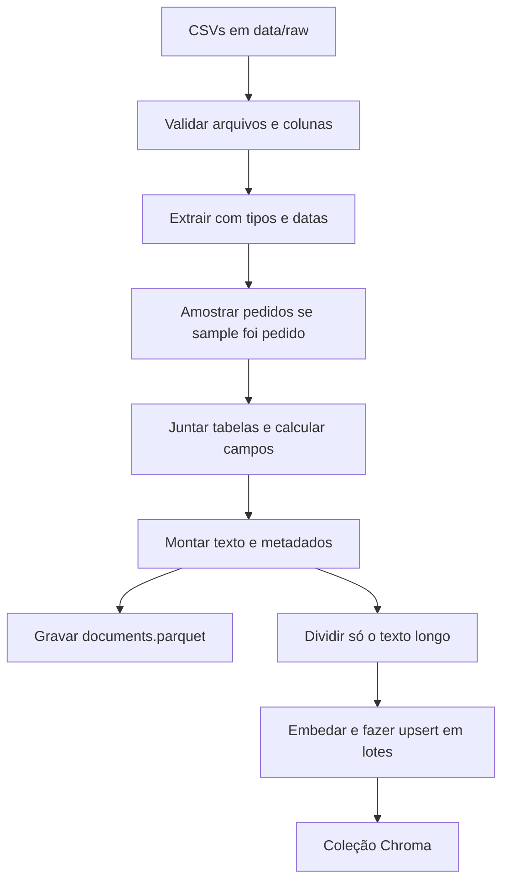

# Decisões da ingestão

Este documento explica como os CSV da Olist viram documentos em `data/processed/documents.parquet` e chunks na coleção persistente em `data/chroma/`. Os números vêm de [`data_profile.md`](data_profile.md), gerado em 25/10/2026 sobre o extrato local.

## Fluxo

A geolocalização para no passo de validação do cabeçalho. O profiler lê o arquivo inteiro; a ingestão não.

## Por que o documento é o pedido

Embeddings em linhas tabulares cruas funcionam mal: uma linha de item não tem cidade, e uma linha de avaliação não tem os produtos. O pedido já é a unidade que amarra esses fatos.

O extrato tem 99.441 pedidos, 112.650 itens, 103.886 pagamentos e 99.224 avaliações. Indexar cada linha criaria documentos duplicados e incompletos:

- 9.803 pedidos têm mais de um item (máximo de 21).
- 2.961 pedidos têm mais de um pagamento (máximo de 29).
- 547 pedidos têm mais de uma avaliação (máximo de 3).

Cada `order_id` vira um único documento. Itens iguais (mesmo produto, vendedor e preço unitário) entram como `Nx`. Pagamentos e avaliações aparecem em sequência, sem clonar o pedido.

775 pedidos não têm linha em itens. O documento ainda existe: a frase de itens é omitida e o total cai para a soma dos pagamentos, ou para zero se também não houver pagamento.

`customer_id` é único nos dois lados da junção (99.441 e 99.441). A pessoa se repete em `customer_unique_id` (96.096), mas o arquivo de clientes está no grão do pedido. A junção usa `customer_id`.

## Campos derivados

- Atraso em dias: data de entrega ao cliente menos a data estimada, pelas datas de calendário. A coluna estimada é uma data à meia-noite; o horário da entrega não deve mudar a contagem. Positivo significa atraso, negativo significa adiantamento. A data estimada está preenchida em 100% dos pedidos. A data de entrega ao cliente está vazia em 2,98% das linhas, entre elas 8 pedidos já marcados como `delivered` (de 96.478). Sem o par de datas, o metadado recebe `-9999` e a frase de atraso sai do texto.
- Valor total: soma de `payment_value` quando existe pagamento, porque esse valor é o que foi pago e já inclui frete e voucher. Sem pagamento, a soma é preço mais frete dos itens.
- Quantidade de itens: número de linhas de item, que neste dataset é uma unidade por linha.
- Nota no metadado do pedido: a menor nota daquele pedido. Um filtro `review_score <= 2` continua encontrando o pedido mesmo quando outra avaliação dele é alta. O texto lista cada nota.
- Categoria e UF do vendedor no metadado: vêm do item de maior preço. Chroma não aceita lista, e o texto continua enumerando todas as linhas.

## Nulos

O texto não imprime `nan` nem `None`. A frase some quando o campo está vazio.

- Comentário de avaliação vazio em 58,70% das linhas (40.950 de 99.224 preenchidos, 41,27%). Título vazio em 88,34% (11.566 preenchidos).
- 610 produtos (1,85%) não têm categoria. O texto diz `uncategorized product` e o metadado do pedido fica com string vazia.
- Duas categorias não estão no arquivo de tradução: `pc_gamer` e `portateis_cozinha_e_preparadores_de_alimentos`. O nome em português é mantido, sem tradução inventada.
- Há 2 pagamentos com `payment_installments` igual a 0. Essa parcela não entra na frase.
- Cidade ou UF ausente: a localização é omitida, ou só a parte que existe é escrita. No extrato, `customer_state` não tem nulos (27 UFs). SP concentra 41.746 pedidos (41,98%).

## Geolocalização

O arquivo tem 1.000.163 linhas e apenas 19.015 prefixos de CEP, média de 52,60 linhas por prefixo. Indexar isso linha a linha encheria a coleção de coordenadas repetidas, que o modelo não recupera como texto. Cidade e UF já estão em clientes e vendedores, e o modelo de documento não usa latitude nem longitude. O arquivo entra na validação de esquema e no perfil. A ingestão não o carrega.

## Outros documentos

Os dois tipos abaixo nascem ligados por configuração (`ENABLE_REVIEW_DOCUMENTS` e `ENABLE_AGGREGATE_DOCUMENTS`, ambos verdadeiros por padrão). `--doc-types` substitui essas flags na execução.

- `review`: uma avaliação com comentário não vazio. São o melhor texto para perguntas como "do que os clientes reclamam?". O comentário em português permanece literal. No extrato completo seriam 40.950 documentos; numa amostra, só as avaliações dos pedidos sorteados.
- `category_summary` e `state_summary`: um texto curto por categoria e por UF do cliente, com contagem de pedidos, nota média, atraso médio e preço médio. A categoria usa o preço médio do item. A UF usa o valor médio do pedido. Um pedido com dois itens de categorias diferentes entra nas duas médias, e as avaliações dele também, porque a nota é do pedido. Pedido sem data de entrega não entra na média de atraso. Na amostra, os agregados usam só os pedidos sorteados.

## Metadados

Chroma aceita apenas `str`, `int`, `float` e `bool`. Não há `None` nem lista. Strings ausentes viram `""`. Nota ausente vira `-1`. Atraso ausente vira `-9999`. Ano e mês ausentes viram `0`.

| Campo | Conteúdo |
| --- | --- |
| `doc_type` | `order`, `review`, `category_summary` ou `state_summary` |
| `entity_id` | `order_id`, `review_id`, categoria ou UF. Também entra no id do chunk |
| `order_id` | Pedido, ou `""` nos resumos |
| `customer_state` | UF do cliente, ou `""` |
| `customer_city` | Cidade do cliente, ou `""` |
| `seller_state` | UF do vendedor do item mais caro, ou `""` |
| `product_category` | Categoria em inglês quando existe; senão o nome em português; `""` se não houver |
| `order_status` | Status do pedido, ou `""` nos resumos |
| `purchase_year` | Ano inteiro da compra, ou `0` |
| `purchase_month` | Mês inteiro da compra, ou `0` |
| `review_score` | Inteiro. No pedido, a menor nota. Na avaliação, a nota daquela linha. No resumo, a média arredondada. `-1` se não houver nota |
| `total_value` | Total do pedido, ou a média correspondente no resumo |
| `delivery_delay_days` | Dias de atraso, ou `-9999` |
| `source_files` | CSV de origem, separados por vírgula |
| `chunk_index` | Índice do pedaço, `0` quando o documento não foi dividido |

Um filtro futuro pode usar, por exemplo, `{"customer_state": "SP", "review_score": {"$lte": 2}}`.

`source_files` não inclui a geolocalização, porque ela não entra no texto.

## Chunking

O divisor é o `RecursiveCharacterTextSplitter`, com 1000 caracteres e sobreposição de 150. Ele só roda quando o texto passa de 1000 caracteres. A maior parte dos pedidos é curta: 87,59% das linhas de item são o primeiro item do pedido. Separar um pedido curto afastaria a nota dos produtos. Um pedido com muitos itens (o máximo observado é 21) ou um comentário longo ainda é dividido, e cada pedaço copia os metadados e ganha `chunk_index`. Na amostra de 1.000 pedidos, os 1.495 documentos ficaram todos abaixo de 1000 caracteres, então nenhum foi dividido.

## Embeddings

Os comentários estão em português do Brasil. O modelo padrão é `sentence-transformers/paraphrase-multilingual-MiniLM-L12-v2`, local, gratuito e reproduzível, via `HuggingFaceEmbeddings`. Os vetores são normalizados e o índice HNSW usa distância cosseno. A inferência fica na CPU para o mesmo resultado em máquinas com ou sem GPU.

`EMBEDDING_PROVIDER=openai` troca para `OpenAIEmbeddings`, mas o pacote `langchain-openai` não faz parte da instalação padrão: o import só acontece quando esse provedor é escolhido. Trocar o modelo exige `--reset`. A coleção guarda o nome do modelo e recusa vetores de outro modelo ou de outro `sample_size` (0 significa a tabela inteira de pedidos).

## Ids e reexecução

O id de cada chunk é o SHA-256 de `doc_type|entity_id|chunk_index`. A gravação usa `upsert`. Rodar de novo substitui os mesmos ids. Se um documento encolher, a ingestão apaga até 20 ids seguintes daquela entidade, para não deixar pedaço órfão. A primeira carga de uma coleção vazia não faz essa varredura.

## Amostra e lote

`--sample N` sorteia N pedidos com `random_state` 42 e filtra itens, pagamentos, avaliações e clientes por esses ids. Os resumos saem dessa mesma população. O valor gravado em `sample_size` é N, ou o total de pedidos se N for maior que a tabela. Sem `--sample`, `sample_size` fica 0.

O embedding e o upsert andam em lotes de 500, com barra `tqdm`. Há cerca de 100 mil pedidos na carga completa; a amostra de 1000 existe para desenvolver sem esperar a coleção inteira.

## O que esta camada não faz

Não há retriever, prompt, geração com LLM nem interface. `scripts/inspect_collection.py` só confere a coleção com três buscas por similaridade. A camada de consulta, quando existir, lê esta coleção e pode filtrar pelos metadados acima.
